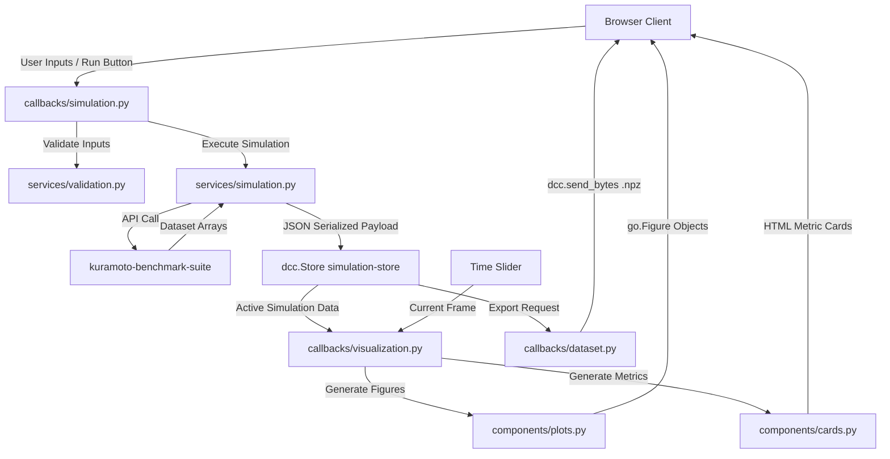

# Requirements

### Overview & Goals
The goal of this architectural refactoring is to transition the standalone, monolithic Kuramoto exploration script (`app/replit-app.py`) into a clean, modular Dash application structure while integrating the core simulation algorithms from the `kuramoto-benchmark-suite` repository.

Refactoring monolithic scientific dashboards into structured, loosely-coupled modules maximizes computational reliability, accelerates future feature development, and ensures reproducible research datasets can be generated and exported efficiently.

### Scope
- **In Scope:**
  - Decomposing `app/replit-app.py` into dedicated modules: configuration (`config.py`), services (`services/`), components (`components/`), callbacks (`callbacks/`), layout (`layout.py`), and entrypoint (`app.py`).
  - Integrating simulation routines (`generate_kuramoto_dataset`, topology loaders, and solver interfaces) from `kuramoto-benchmark-suite`.
  - Maintaining exact feature parity: 6 interactive Plotly visualizers (Phase field unit circle, Coupling network, Order parameter $r(t)$, Frequency distribution, Phase history heatmap, and Unwrapped trajectories), animation controls, and compressed `.npz` benchmark export.
  - Adding unit and integration tests under `tests/`.

- **Out of Scope:**
  - Modifying the underlying mathematical solver algorithms inside `kuramoto-benchmark-suite`.
  - Changing visual styling or assets beyond wiring existing CSS/images in `assets/`.

### User Stories
- **As a researcher/user**, I want an interactive, responsive dashboard to parameterize oscillator count, coupling strength $K$, natural frequency distributions, and network topologies so that I can study synchronization transitions in real time.
- **As a computational scientist**, I want to export simulated states as compressed `.npz` files matching the benchmark suite schema so that I can run offline evaluations and model comparisons.
- **As a developer**, I want a modular codebase with clear separation of concerns (services, components, callbacks) so that visual components and numerical routines can be maintained and tested independently.

### Functional Requirements
- **Parameter Configuration:** Support configuring oscillator count ($N \in [2, 100]$), coupling constant $K$, total simulation time, time step $dt$, solver type (RK45, Euler), frequency distributions (Normal, Uniform, Bimodal, Golden Ratio, Custom), and network topologies (All-to-All, Ring, Random).
- **Simulation Execution & State Management:** Store simulation output in client-side `dcc.Store` containing time series, phase matrices $\theta(t)$, order parameter $r(t)$, frequency vectors, and network adjacency matrices.
- **Visual Analytics:** Provide real-time rendering of all 6 diagnostic charts, synchronized with an interactive time-slider and animation playback controls.
- **Dataset Export:** Generate and trigger downloads of `.npz` archives containing simulation arrays and metadata on demand.

### Non-Functional Requirements
- **Maintainability:** Strict separation between UI layout, reactive callbacks, and numerical computation.
- **Performance:** Efficient serialization of NumPy arrays to prevent UI thread blocking during frame scrubbing.
- **Reproducibility:** Deterministic simulation runs given identical random seed inputs.

# Technical Design

### Current Implementation
The current codebase contains a single-file implementation in `app/replit-app.py` that mixes Dash layout definition, Plotly figure generation, numerical simulation helpers, and callback logic in one ~500 line script. The project repository already contains an empty modular scaffold:
- `app/` (`config.py`, `layout.py`, `app.py`, `callbacks/`, `components/`, `services/`)
- `assets/` (`css/style.css`, `images/`)
- `tests/` (`test_app.py`, `test_callbacks.py`, `test_components.py`, `services.py`, `integration.py`)

In parallel, `kuramoto-benchmark-suite` (located at `../kuramoto-benchmark-suite`) contains tested numerical simulation models (`kuramoto.model.KuramotoModel`, `kuramoto.api.generate_kuramoto_dataset`, `kuramoto.topologies`).

### Key Decisions
1. **Local Package Integration:** Link `kuramoto-benchmark-suite` directly into `kuramoto-dash-app` via `pyproject.toml` or python path rather than duplicating simulation code, maximizing code reuse and preventing divergence between dashboard behavior and benchmark standards.
2. **Layered Service Architecture:** Route simulation calls through `app/services/simulation.py` and `app/services/benchmark.py`, decoupling Dash callbacks from the low-level numerical solvers.
3. **Component-Based UI Decomposition:** Split controls, metric cards, and charts into standalone pure functions in `app/components/` that receive data and return Dash/Plotly objects.
4. **Decoupled Callbacks:** Segregate callbacks by domain into `callbacks/simulation.py` (run/reset logic), `callbacks/visualization.py` (chart updates on slider tick), and `callbacks/dataset.py` (animation loop and file download).

### Proposed Architecture & Data Flow

### Components and File Structure

#### 1. Configuration & Services
- `app/config.py`: Default simulation parameters (`DEFAULTS`), color scale definitions (`NETWORK_COLORSCALE`), layout metadata.
- `app/services/validation.py`: Input boundary and type validation for parameters ($N$, $K$, $dt$, frequencies).
- `app/services/simulation.py`: Interfaces with `kuramoto.api.generate_kuramoto_dataset`, parses topologies, and structures output arrays.
- `app/services/benchmark.py`: Handles export packaging and serialization into compressed `.npz` binary payloads.

#### 2. UI Components & Layout
- `app/components/controls.py`: Control panels, numeric inputs, distribution dropdowns, topology selectors, action buttons.
- `app/components/cards.py`: Metric stat cards (Order $r$, Peak $r$, Time step, Oscillator count) and model equation card.
- `app/components/plots.py`: Pure functions returning `go.Figure` for:
  - `unit_circle_figure(theta, order, order_phase, colors)`
  - `order_figure(time, order, frame)`
  - `phase_heatmap_figure(time, theta)`
  - `phase_trajectories_figure(time, theta, frequencies)`
  - `network_figure(adjacency, frequencies, seed)`
  - `frequency_distribution_figure(frequencies)`
  - `empty_figure(title, message)`
- `app/layout.py`: Composes header, hero section, sidebar controls, timeline controls, and visualization grid into `create_layout()`.

#### 3. Callbacks & Application Root
- `app/callbacks/simulation.py`: Handles `run-btn` and `reset-btn`, computes dataset, populates `simulation-store`.
- `app/callbacks/visualization.py`: Listens to `simulation-store` and `time-slider`, computes current frame values, updates figures and metrics.
- `app/callbacks/dataset.py`: Handles `download-btn` (.npz export) and `heartbeat` / `play-btn` animation progression.
- `app/callbacks/__init__.py`: Helper function `register_callbacks(app)` to wire all callback modules cleanly.
- `app/app.py`: Instantiates `Dash(__name__)`, sets custom index string and assets folder, assigns layout, registers callbacks, exposes `server`.

### Risks and Mitigations
- **Large State Payloads:** High oscillator counts or long simulation times could lead to large `dcc.Store` memory usage.
  - *Mitigation:* Enforce maximum oscillator count ($N \le 100$) and downsample animation frames if necessary.
- **Import Conflicts:** Ensuring `kuramoto-benchmark-suite` module names do not collide with local `app` files.
  - *Mitigation:* Explicit absolute packaging (`from kuramoto.api import ...`).

# Testing

### Validation Approach
Automated tests ensure numerical fidelity, component rendering correctness, and callback state transitions without requiring manual browser testing.

### Key Scenarios
1. **Simulation Service Execution:**
   - Verify `generate_dataset` produces matching output keys: `time`, `theta`, `order_parameter`, `frequencies`, `adjacency`.
   - Validate that setting random seeds produces identical numeric outputs across runs.
2. **Plot Generation:**
   - Verify all 6 figure functions in `app/components/plots.py` generate valid `go.Figure` instances with proper trace counts and layout bounds.
   - Verify `empty_figure` renders correctly prior to simulation runs.
3. **Callback Logic:**
   - Verify `run_or_reset` handles reset triggers by clearing store data.
   - Verify `advance_animation` loops back to 0 when reaching final frame.
   - Verify `.npz` export packaging creates a valid compressed archive containing expected arrays.

### Test Implementation Plan
- `tests/services.py`: Unit tests for `app/services/simulation.py` and `app/services/validation.py`.
- `tests/test_components.py`: Snapshot and type validation for `app/components/plots.py` and `app/components/cards.py`.
- `tests/test_callbacks.py`: Isolated callback function tests with mock inputs/states.
- `tests/integration.py`: End-to-end simulation-to-export verification.

# Delivery Steps

### ✓ Step 1: Integrate benchmark suite dependency and environment configuration
The simulation engine from `kuramoto-benchmark-suite` is connected and available to the Dash application environment.

- Add `kuramoto-benchmark-suite` as an editable/local path dependency or package in `pyproject.toml` (e.g., `kuramoto = { path = "../kuramoto-benchmark-suite", editable = true }`).
- Verify access to core modules: `kuramoto.api.generate_kuramoto_dataset`, `kuramoto.model.KuramotoModel`, and `kuramoto.topologies`.
- Run dependency synchronization using `uv sync` or `pip install -e` within the virtual environment.

### ✓ Step 2: Modularize configuration and core simulation services
Core constants, configuration dictionaries, and simulation business logic are isolated into dedicated service modules.

- Populate `app/config.py` with simulation defaults (`DEFAULTS`), color maps (`NETWORK_COLORSCALE`), layout metadata, and server options.
- Implement `app/services/validation.py` to validate user inputs (bounds on oscillator counts, step size `dt`, simulation time, seed).
- Implement `app/services/simulation.py` and `app/services/benchmark.py` to bridge Dash parameter states with `kuramoto.api.generate_kuramoto_dataset`, handling frequency distributions and adjacency construction.

### ✓ Step 3: Construct reusable UI components and Plotly visualization modules
All visual elements and interactive controls from `replit-app.py` are decomposed into modular component factories.

- Implement `app/components/controls.py` defining input fields, parameter sliders, solver radio options, and action buttons.
- Implement `app/components/cards.py` for metric summaries (order parameter $r$, peak $r$, time step) and model equation display.
- Implement `app/components/plots.py` with factory functions for Plotly figures: unit circle phase field, order parameter over time, oscillator phase heatmap, unwrapped phase trajectories, coupling network graph, and natural frequency histogram.

### ✓ Step 4: Assemble layout, register reactive callbacks, and connect entry point
The Dash application layout is composed and interactive callbacks are wired across specialized callback modules.

- Implement `app/layout.py` structuring the header, hero section, control sidebar, timeline slider, and visualization grid using components from `app/components/`.
- Implement `app/callbacks/simulation.py` handling simulation execution, reset actions, and store updates.
- Implement `app/callbacks/visualization.py` updating all 6 Plotly graphs and metric cards when the timeline slider moves or new data is stored.
- Implement `app/callbacks/dataset.py` managing timeline animation intervals and compressed `.npz` benchmark downloads.
- Assemble and expose the application entry point in `app/app.py`.

### * Step 5: Implement automated unit and integration tests
A testing suite validates component generation, simulation execution, and callback logic without manual browser interaction.

- Implement `tests/services.py` to verify simulation outputs, array shapes, and validation error handling.
- Implement `tests/test_components.py` to verify figure generators return valid Plotly `go.Figure` instances for both empty and populated states.
- Implement `tests/test_callbacks.py` and `tests/integration.py` to test state transitions and `.npz` export payloads.
- Run test suite with `pytest` to confirm full pipeline integrity.